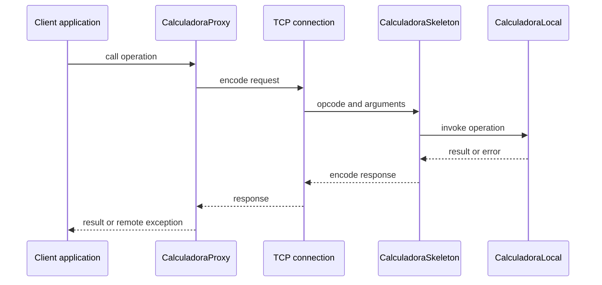

# Distributed Systems Coursework

A Java collection of coursework projects exploring how networked programs communicate, how concurrent clients share server-side state, and how remote calls can be presented through familiar Java interfaces. The examples progress from basic TCP sockets to typed protocols, synchronized services, and a small RPC-style client/server design.

## Project layout

```
distributed-systems-proyects/
└── src/
    └── main/
        ├── java/
        │   ├── project02/
        │   ├── project03/
        │   ├── project04/
        │   │   ├── bank/
        │   │   └── echo/
        │   ├── project05/
        │   │   ├── cliente/
        │   │   ├── comun/
        │   │   └── servidor/
        │   └── project06/
        │       ├── calculadora/
        │       └── rpc/
        └── resources/
            ├── project02/
            ├── project03/
            ├── project04/
            ├── project05/
            └── project06/
```

The source packages mirror the numbered coursework folders. Shared protocol definitions live alongside the projects that use them, keeping each example independently understandable.

## Coursework and packages

### `project02` — TCP sockets and text streams

Introduces the client/server model with a line-oriented TCP echo service. `ClienteEcoTCP` reads text from standard input, sends each line, and prints the server's reply; `ServidorEcoMonohilo` accepts one connection at a time and returns received lines. This exercise focuses on socket setup, stream wrapping, blocking reads, end-of-stream, and resource cleanup.

### `project03` — Concurrent clients and thread-per-connection servers

Extends the echo example to handle several client connections concurrently. `ServidorEcoMultihilo` accepts a bounded number of connections and starts a `ServicioEco` thread for each; `LanzarClientes` is an additional client launcher class. The objective is to separate accepting connections from servicing them, and to observe per-client activity while multiple sessions overlap.

### `project04` — Typed binary protocols and a remote bank

This coursework explores structured messages over TCP and the design of a small request/response protocol.

- **`project04.echo`** is a typed echo exercise built around `DataInputStream` and `DataOutputStream`. Its protocol carries an integer, a double, and a UTF string, illustrating that both ends must read and write values in the same order.
- **`project04.bank`** organizes a bank-service exercise around accounts, a shared opcode protocol, a TCP server, and a client-side `BankProxy`. The proxy presents operations such as balance queries and deposits as Java method calls while handling wire-format details. Supporting demos explore timeouts and concurrent updates; the optional transfer operation highlights atomicity and deadlock-safe locking.

Together these packages cover message framing, marshalling/unmarshalling, protocol dispatch, session lifetimes, timeouts, and synchronization of shared state.

### `project05` — Resource contention and a concurrent ticket service

Models five philosopher clients competing for a limited number of computers and keyboards while purchasing seats from a TCP ticket server.

- **`project05.cliente`** coordinates philosopher threads and shared resource locks. Philosophers acquire a computer and keyboard, connect to the theatre, and collect tickets while handling contention and retries.
- **`project05.servidor`** contains the theatre, ticket-counter, and seat-allocation components. Multiple ticket-window threads serve clients while sharing limited seats and window capacity.
- **`project05.comun`** holds the protocol and logging utilities shared by client and server.

The coursework brings together network protocols and concurrent programming: bounded service capacity, atomic seat sales, lock acquisition, timeouts, and coordination between independently running client and server processes.

### `project06` — RPC, proxies, and request semantics

Looks at the boundary between a local method call and an operation performed by a remote process.

- **`project06.rpc`** is a compact socket-based RPC example: the client names an operation and sends arguments, while the server dispatches the request and returns a result.
- **`project06.calculadora`** builds a more structured calculator service. `Calculadora` defines the service contract; `CalculadoraLocal` is a local implementation; `CalculadoraProxy` implements the same interface over TCP; and `CalculadoraSkeleton` decodes requests and invokes the server-side implementation. `Protocolo` defines the wire format, while the demos compare local and remote calls and exercise the stateful accumulator.

This project focuses on interface-based service boundaries, request encoding, remote errors, timeouts, retries, and call identifiers for recognizing repeated requests.

## Example request flow

The calculator project separates the application-facing contract from the network protocol. The client can select a local implementation or a proxy; in the remote case, the server-side skeleton dispatches the decoded operation to the calculator implementation.



## Build and run

The project targets **Java 21** and uses Maven. The examples use only Java standard-library APIs; there are no third-party runtime dependencies.

```bash
mvn clean package
```

After compilation, run a class from the project root using `target/classes` as the classpath. For example, start the project 2 server in one terminal and its client in another:

```bash
java -cp target/classes project02.ServidorEcoMonohilo
java -cp target/classes project02.ClienteEcoTCP
```

Other useful entry points include `project03.ServidorEcoMultihilo`, `project04.bank.BankServer`, `project04.bank.BankClientDemo`, `project05.servidor.Teatro`, `project05.cliente.Filosofos`, `project06.calculadora.ServidorCalculadora`, and `project06.calculadora.DemoCalculadora`. Start the relevant server before its client and check each class for its supported arguments and configured port.

Across the coursework, the emphasis moves from socket and stream fundamentals to protocol contracts, concurrent access to shared state, and RPC abstractions that separate an application interface from network transport.
